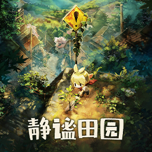

# Village in the Shade (Honogurashi no Niwa) - Switch Simplified Chinese Localization Project & Engineering Toolchain
# 《静谧田园 (ほの暮しの庭)》Nintendo Switch 简体中文完整汉化补丁与工程工具链

<p align="center">
  
</p>

<p align="center">
  <b>100% Complete Simplified Chinese Localization for Nintendo Switch's <i>Village in the Shade (ほの暮しの庭)</i></b><br>
  Atmosphere LayeredFS Zero-NSP-Modification Patch · Handheld 32px Large Font Rebalance · LXGW WenKai Mono Font System · Official PC Vector Texture Redirection · Reconstructed FAD Texture Descriptors
</p>

<p align="center">
  <a href="README.md"><b>简体中文</b></a> | <a href="README_EN.md"><b>English</b></a>
</p>

<p align="center">
  
  
  
  
  
  
  
</p>

---

## 📖 Project Overview

*Village in the Shade* (*ほの暮しの庭 / Honogurashi no Niwa*) is a slow-paced countryside life simulation RPG steeped in Japanese folklore and supernatural mythology.
The original Nintendo Switch Asian commercial release only provided Japanese and Traditional Chinese language options. This introduced numerous issues for Simplified Chinese players:
1. **Uncalibrated Regional Phrasing**: Over-reliance on Taiwanese grammatical particles and colloquialisms flattened distinctive character personalities;
2. **Tiny Font Size on Handheld**: During console porting, Chinese dialogue fonts were downscaled from the Japanese original's 32px to 26px, rendering characters at under 17px on the Switch's 720p screen and causing severe visual fatigue;
3. **Baked-in Traditional Chinese Text in UI/Mini-map**: 18 mini-map locations and copyright notices were baked as textures into the large texture archive, remaining unlocalized in Chinese;
4. **Font Deficiencies & Misalignments**: Incomplete character coverage causing missing glyph boxes (□), and uneven monospacing between Latin numerals and Chinese ideographs.

**This project delivers a 100% comprehensive, production-grade Simplified Chinese localization for the Nintendo Switch release.** By reverse-engineering the viewport rendering engine, `FAFULLFS` virtual file archives, NVN Tegra Block Linear swizzling, and FAD descriptor chains, this project provides a native, immersive experience faithful to official mainland linguistic standards.

---

## ✨ Key Technical Achievements & Features

### 1. 100% Full Translation with Deep Persona Calibration
- **Complete Scope**: Covers System UI, World Metadata, Flora & Fauna, Quests & Tutorials, Lore Books & Mythological Letters, Staff Credits, Item Descriptions, and Daily Dialogue across **294 batches and 56,747 bilingual lines** (including full v1.3.0 villager birthday celebrations, birthday quest, new items, and letters);
- **Deity vs. Monster Pronoun Rule**: Strict theological distinction between ancient sacred gods (divine honorific **祂 / 祂们**) and ordinary monsters, spirits, or animals (**它 / 它们** or **他 / 他们**);
- **Taiwanese Phrasing Cleansing**: 1,829 lines of awkward particles (`囉/喔/耶/唷/捏/咧`) were completely replaced with natural modern Mandarin expressions;
- **Vivid Persona Preservation**: Reconstructed Konno's sarcastic elongated speech (`～`), Rokkaku's bustling street food dialect (`～っス`), Tobari's cold and prickly demeanor, and Kodama's stuttering whispers.

### 2. Handheld 1.2x Scaled Large Font & Engine-Level Baseline Calibration
- Reverse engineering proved that the game engine includes built-in auto-fit logic (`枠内に収めるための拡縮処理`) to dynamically compress character spacing when text overflows boundaries;
- **1.2x Large Font Profile**: Upscaled all font sizes by 1.2x based on the Japanese original baseline (Big Title `46px`, Game UI/Dialogue `38px`, Books/Small Text `29px`), delivering over 110% larger glyph render area for supreme readability on 720p handheld screens;
- **Engine-Level Baseline Calibration**: Reverse-engineered the `village.exe` FreeType pipeline and adjusted global `offsetY` fields in `font.dat`, completely resolving the 4px downshift bug in the Traditional Chinese slot and achieving pixel-perfect vertical centering across interaction balloons (`Ⓐ`) and action bars (`Ⓡ`).

### 3. PC-Grade Official Font: LXGW WenKai Mono v1.530
- Integrated **LXGW WenKai Mono (霞鹜文楷等宽) v1.530 Medium (500)** to mirror the aesthetic weight of the PC release;
- **Full Glyph Coverage**: 46,946+ codepoints covering GB2312, GB18030, and specialized biological characters with 0 missing glyphs;
- **Monospaced Layout**: Enforces exact 1:2 alignment between half-width ASCII numbers and full-width Chinese characters, eliminating layout jitter in tables and dialogue boxes;
- Dual-weight compiler support: `--weight medium` (default, recommended) and `--weight regular`.

### 4. Zero-Expansion Mini-Map & UI Texture Redirection
- 18 mini-map landmark names and main menu copyright notices were originally baked inside the 1.15 GB `fairy_1_00.dat` archive;
- By reverse-engineering `texture.dat` and `framework_texture.dat`, UV coordinates and texture slice pointers were redirected to PC official Simplified Chinese vector primitives;
- **Result: 100% vector-sharp Simplified Chinese mini-map names with 0 bytes of patch size inflation!**

### 5. UI Texture Archive Re-Packaging & P0 Crash Fixes
- Fully reconstructed `resident_lang_tc.fad` inside `fairy_1_00.dat` across 413 texture descriptor streams and dynamically arranged the new `resident_v130.fad` (5.13 MB) archive;
- **Resolved 4 Critical P0 Crash Defects**:
  1. **P0-1 Compression Length Fix**: Rectified `comp_sz` in `YKCMP_V1` and `ints[12]` in `NMPLTEX1` to include the 20-byte header, resolving the 100% crash rate in `LZ4_decompress_safe`;
  2. **P0-2 Pixel Format Alignment**: Upgraded 61 texture descriptors to standard BC3 (`0x07`) with synchronized decompression buffers;
  3. **P0-3 Dynamic Tegra Swizzle Block Height**: Extracted `block_height_log2` directly from `ints[14] & 0xFF`, preventing screen tearing;
  4. **P0-4 Master Texture Table Synchronization**: Synchronized the 413 absolute offsets and steps at offset `0xd00`, fixing the fatal first-frame unmapped memory deadlock!
- Re-packaged **66 localized textures**, including the calligraphic title logo, main menu buttons, crop inspection popups, and town bulletin flyers.

### 6. Switch Home Menu Icon & NACP Metadata
- Injected Simplified Chinese title 《静谧田园》 and publisher metadata into NACP Slots 13 & 14, and updated `config.ini` to version 1.3.0;
- Provided a high-resolution custom Switch Home menu icon (`icon.jpg`), compatible with Atmosphere's `sys-tweak` and `sys-icon` sysmodules.

### 7. Strict Automated Quality Gate
- `tools/validate_batch.py` runs 8 automated integrity checks on all 294 batches;
- **Current Status**: 294/294 batches passed with **0 Errors and 0 Warnings (100% Pass Rate)**.

---

## 📥 Installation Guide

### Prerequisites
- **Target Game**: Nintendo Switch *ほの暮しの庭 / Village in the Shade*
- **Required Game Version**: Base + Update `v1.3.0` (Internal Version `v458752`, backwards compatible with v1.2.0)
- **TitleID**: `01001BA027DD8000`

---

### Real Hardware (Atmosphere LayeredFS)
1. Turn off your Nintendo Switch and connect its MicroSD card to your PC (or use DBI MTP mode);
2. Download or locate the patch directory `output/atmosphere` (or extract `静谧田园简体中文补丁-v1.3.0.zip`);
3. Copy the entire `atmosphere` folder directly into the root directory of your Switch MicroSD card:
   ```text
   SDCard:/
   └── atmosphere/
       └── contents/
           └── 01001BA027DD8000/
               ├── icon.jpg                          # (Optional: sys-tweak custom icon)
               ├── config.ini                        # (sys-icon title & version override)
               ├── control/                          # (NACP title and icon metadata)
               │   ├── control.nacp
               │   ├── icon_SimplifiedChinese.dat
               │   └── icon_TraditionalChinese.dat
               └── romfs/data/
                   ├── database/                     # (Core: 47 localized databases & 32px font metrics)
                   │   ├── talk.dat
                   │   ├── item.dat
                   │   ├── font.dat
                   │   └── ... (47 files, 22.93 MB)
                   ├── misc_1_00.dat                 # (Core: LXGW WenKai font archive, 164.36 MB)
                   └── fairy_1_00.dat                # (Optional: Reconstructed UI texture archive, 1.212 GB)
   ```
4. Re-insert the MicroSD card into your Switch, boot via Atmosphere, and launch the game.

> [!TIP]
> **Switch Home Menu Icon**:  
> Atmosphere's native LayeredFS hook applies to `romfs/`. To display the custom Chinese Home menu icon and title on the official Switch dashboard, install the popular Atmosphere sysmodule **`sys-tweak`** or **`sys-icon`**.

---

### PC Emulators (Eden / Ryujinx / Yuzu)

#### Eden Emulator
1. Navigate to your Eden Mod directory:
   `%APPDATA%\eden\load\01001BA027DD8000\Village_SC_Translation\`
2. Place the `output/atmosphere/contents/01001BA027DD8000/romfs/` folder into this directory;
3. Launch Eden and open the Base NSP to boot directly into Simplified Chinese.

#### Ryujinx
1. Right-click the game in your Ryujinx game list and select **Open Atmosphere Mods Directory**;
2. Create a folder named `Village_SC_Translation`;
3. Copy the `romfs` directory into it;
4. Launch the game in Ryujinx.

---

## 🛠️ Developer CLI & Toolchain

The project includes a portable Python toolchain located in `tools/`:

### 1. Validate Batches (QA Gate)
```powershell
# Validate all 294 batches (enforces 0 Errors / 0 Warnings)
python tools/validate_batch.py all

# Validate a single batch
python tools/validate_batch.py batch_004_sys_ui.json
```

### 2. Build Database Patch (LayeredFS)
```powershell
# Compiles all 47 binary .dat databases to output/atmosphere/...
python tools/build_patch.py
```

### 3. Rebuild Font Archive (`misc_1_00.dat`)
```powershell
# Build with Medium 500 weight (default, matches PC version)
python tools/build_font_patch.py

# Build with Regular 400 weight
python tools/build_font_patch.py --weight regular
```

### 4. Build UI Texture Archive (`fairy_1_00.dat`)
```powershell
# Route B: Re-pack all 66 textures upgraded to BC3 (title logo, popups, menus, flyers)
python tools/build_fairy_patch.py --mode all

# Route A: Safe mode (replaces only the 5 native 0x07 BC3 textures)
python tools/build_fairy_patch.py --mode safe
```

### 5. Apply Control Metadata & Switch Home Icon
```powershell
python tools/apply_control_patch.py
```

### 6. Translation Progress & Target Scanning
```powershell
# View translation and QA progress
python tools/batch_status.py

# Scan for pronouns, deity keywords, aspect particles, and speech tics
python tools/scan_calibration_targets.py
```

---

## 📂 Repository Layout

```text
Village-SC/
├── docs/                                     # Technical and localization documentation
│   ├── ARCHITECTURE.md                       # Reverse engineering manual for FAFULLFS, FAD & Swizzle
│   ├── BUILD_GUIDE.md                        # Compilation pipeline and deployment guide
│   ├── LOCALIZATION_GUIDE.md                 # Translation rules, pronouns, forbidden terms & personas
│   ├── CRASH_AUDIT.md                        # Investigation and resolution report for P0 crash defects
│   └── NON_MAINLAND_AUDIT.md                 # Audit report for Taiwanese phrasing cleansing
├── output/                                   # Built Atmosphere LayeredFS patch assets
│   └── atmosphere/contents/01001BA027DD8000/
│       ├── icon.jpg                          # sys-tweak custom dashboard icon
│       ├── control/                          # NACP metadata and icon backups
│       └── romfs/data/
│           ├── database/                     # 47 localized .dat files (including 32px font.dat)
│           ├── misc_1_00.dat                 # LXGW WenKai Mono v1.530 font archive (164.36 MB)
│           └── fairy_1_00.dat                # Localized UI texture archive (1.08 GB)
├── switch_icons/                             # Switch Home menu icons (PNG / JPG)
├── tools/                                    # Automated Python engineering tools
│   ├── dat_tool.py                           # Binary .dat parser and string pool rebuilder
│   ├── build_patch.py                        # Master database compiler (47 .dat files)
│   ├── build_font_patch.py                   # Font archive builder (misc_1_00.dat)
│   ├── build_fairy_patch.py                  # UI texture builder (fixes P0-4 master offsets)
│   ├── apply_control_patch.py                # Home icon and NACP metadata updater
│   ├── validate_batch.py                     # Multi-dimensional automated QA gate
│   ├── batch_status.py                       # Batch status and progress inspector
│   ├── extract_batches.py                    # Original batch extractor
│   └── scan_calibration_targets.py           # Calibration and persona scanner
├── workspace/                                # Core localization source data
│   ├── batches/                              # 289 JSON translation batches (55,931 lines)
│   ├── font_codepoints.json                  # Unicode glyph whitelist (46,946 codepoints)
│   ├── glossary.json                         # Character personas, taboo terms, and punctuation rules
│   └── manifest.json                         # Index and metadata manifest for all batches
├── PROJECT_HANDOVER.md                       # Master Handover and Technical Reference Document
├── README.md                                 # Main project documentation (Chinese)
└── README_EN.md                              # Main project documentation (English)
```

---

## 📚 Documentation Hub

- 👉 [**PROJECT_HANDOVER.md (Master Handover Document)**](PROJECT_HANDOVER.md) — Comprehensive technical reference with complete version changelogs.
- 👉 [**docs/ARCHITECTURE.md (Reverse Engineering Manual)**](docs/ARCHITECTURE.md) — Detailed breakdown of FAFULLFS containers, FAD chains, Tegra swizzling, and UV redirection.
- 👉 [**docs/LOCALIZATION_GUIDE.md (Localization & Persona Guide)**](docs/LOCALIZATION_GUIDE.md) — Translation guidelines, deity pronoun rules, dialect calibration, and character profiles.
- 👉 [**docs/BUILD_GUIDE.md (Build & Deployment Guide)**](docs/BUILD_GUIDE.md) — Step-by-step instructions for environment configuration, patch compilation, and hardware installation.
- 👉 [**docs/CRASH_AUDIT.md (Crash Root-Cause Audit)**](docs/CRASH_AUDIT.md) — Reverse-engineering investigation documenting the diagnosis and fix for P0 crash defects.
- 👉 [**docs/NON_MAINLAND_AUDIT.md (Linguistic Purity Audit)**](docs/NON_MAINLAND_AUDIT.md) — Comprehensive report on the dialectal cleansing of 55,931 lines.

---

## ⚖️ Disclaimer & License

1. This project is a non-commercial, fan-made localization and reverse-engineering research project created solely for educational and personal gaming use.
2. All copyrights and intellectual property regarding *ほの暮しの庭 / Village in the Shade* belong to the original developer and publisher, **Clouded Leopard Entertainment Inc.**
3. Please support the official release. Commercial redistribution of this project's code, data, or patch artifacts is strictly prohibited.
4. The toolchain code is released under the **MIT License**. The bundled font is based on [LXGW WenKai (霞鹜文楷)](https://github.com/lxgw/LxgwWenKai), licensed under the SIL Open Font License 1.1.
