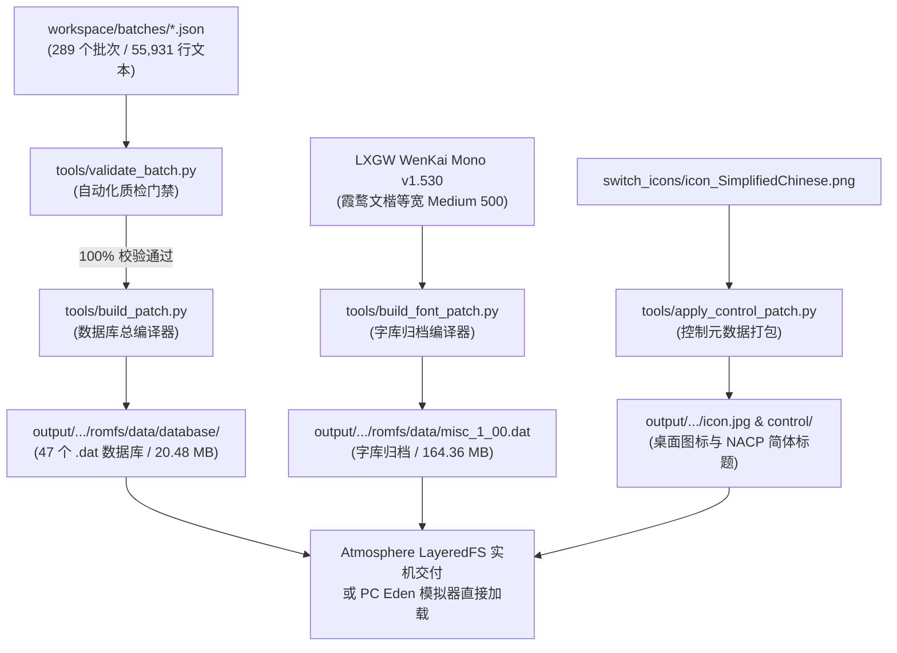

# 《静谧田园 (ほの暮しの庭)》工程编译与实机部署指南
# Build & Deployment Guide

本文档指导开发者、汉化协作者与高级玩家如何从源码批次编译生成《静谧田园 / ほの暮しの庭 / Village in the Shade》（Nintendo Switch 版）的完整汉化补丁，并部署到实机或模拟器中进行体验与测试。

---

## 目录
1. [环境准备 (Prerequisites)](#1-环境准备)
2. [工程自动化流水线概览](#2-工程自动化流水线概览)
3. [核心构建步骤 (Step-by-Step)](#3-核心构建步骤)
   - [步骤一：执行自动化质量门禁](#步骤一执行自动化质量门禁)
   - [步骤二：编译 47 个本地化数据库](#步骤二编译-47-个本地化数据库)
   - [步骤三：编译霞鹜文楷等宽字库归档](#步骤三编译霞鹜文楷等宽字库归档)
   - [步骤四：编译 UI 贴图封包 (可选)](#步骤四编译-ui-贴图封包-可选)
   - [步骤五：打包桌面图标与 NACP 控制元数据](#步骤五打包桌面图标与-nacp-控制元数据)
4. [实机运行与部署 (Nintendo Switch / Atmosphere)](#4-实机运行与部署)
5. [PC 模拟器运行与挂载 (Eden / Ryujinx / Yuzu)](#5-pc-模拟器运行与挂载)
6. [故障排查与常见问题 (Troubleshooting)](#6-故障排查与常见问题)

---

## 1. 环境准备

### 1.1 系统要求
- 操作系统：Windows 10/11 64-bit、Linux 或 macOS；
- Python 版本：Python 3.10 及以上。

### 1.2 Python 依赖库安装
打开终端或 PowerShell，执行以下命令安装依赖：
```bash
pip install pillow fonttools
```
*(若需要重新编译 UI 贴图 `fairy_1_00.dat`，需额外安装 `pyswizzle`)*：
```bash
pip install pyswizzle
```

---

## 2. 工程自动化流水线概览



---

## 3. 核心构建步骤

进入项目根目录：
```powershell
cd D:\Village-SC
```

### 步骤一：执行自动化质量门禁
在编译前，必须运行自动化校验，确保所有批次无格式错误、无未翻译行、控制标签 100% 匹配、无繁体违禁词残留：
```powershell
python tools/validate_batch.py all
```
*预期输出*：`Summary: 289/289 batch(es) passed with 0 errors (Total errors: 0, Total warnings: 0).`

### 步骤二：编译 47 个本地化数据库
运行补丁总编译器，自动重算变长字符串池偏移，无损编译全部 47 个数据库（包括常规数据表、多行布告栏表、角色外观库、小地图矢量重定向路由及 32px 掌机字体配置）：
```powershell
python tools/build_patch.py
```
*编译产物*：`output/atmosphere/contents/01001BA027DD8000/romfs/data/database/*.dat`（共 47 个文件，20.48 MB）。

### 步骤三：编译霞鹜文楷等宽字库归档
将官方 PC 级正统字库（霞鹜文楷等宽 v1.530 Medium 500）注入游戏 `misc_1_00.dat` 归档：
```powershell
python tools/build_font_patch.py
```
*备选参数*：若偏好纤细笔锋，可指定 `--weight regular` 生成常规体（400）版本：
```powershell
python tools/build_font_patch.py --weight regular
```

### 步骤四：编译 UI 贴图封包 (可选)
如果需要替换标题艺术字 Logo、主菜单开始/设定按钮、作物详情弹窗等 66 张图集：
```powershell
# 全量路线 B：66 张贴图全量重打包 (已攻克 P0-4 主索引表与 Swizzle，实测稳定)
python tools/build_fairy_patch.py --mode all

# 极稳路线 A：仅替换 5 张原生 0x07 BC3 贴图 (标题艺术字 Logo 及 4 张大传单)
python tools/build_fairy_patch.py --mode safe
```

### 步骤五：打包桌面图标与 NACP 控制元数据
将简体中文游戏标题《静谧田园》写入 Control NACP 的 Slot 13（繁中）与 Slot 14（简中），并生成 Switch 桌面替换图标：
```powershell
python tools/apply_control_patch.py
```

---

## 4. 实机运行与部署

### 4.1 适用硬件与环境
- 硬件支持：Nintendo Switch 全机型（OLED / v1 / v2 / Lite）；
- 系统固件：推荐 16.0.0 以上；
- 引导环境：Atmosphere（大气层）/ Hekate；
- 游戏版本：基础版 (Base) + 升级补丁 `v1.2.0`（内部版本号 `v393216`，TitleID: `01001BA027DD8000`）。

### 4.2 安装方法
1. 将 Switch 关机并取出 TF/MicroSD 卡（或通过 DBI MTP 连接电脑）；
2. 打开项目产物目录 `output/atmosphere`；
3. 将整个 `atmosphere` 文件夹直接复制并合并覆盖到 Switch TF 卡的根目录下：
   ```
   SDCard:/
   └── atmosphere/
       └── contents/
           └── 01001BA027DD8000/
               ├── icon.jpg                     (桌面图标)
               ├── control/                     (NACP 控制元数据)
               └── romfs/
                   └── data/
                       ├── database/            (47 个 .dat 数据库)
                       ├── misc_1_00.dat        (霞鹜文楷字库归档)
                       └── fairy_1_00.dat       (UI 贴图图集，可选)
   ```
4. 将 TF 卡插回 Switch，启动进入 Atmosphere 虚拟/真实系统，运行游戏即可！

### 4.3 启用桌面图标替换 (sys-tweak)
LayeredFS 原生机制仅针对 `romfs` 与 `exefs` 生效。若想在 Switch 官方主界面直接看到简体中文的《静谧田园》图标：
- 在 Switch 上安装 Atmosphere 插件 `sys-tweak`（或 `sys-icon`）；
- 插件会自动读取 `contents/01001BA027DD8000/icon.jpg`，开机即可看到华丽的简体中文桌面图标。

---

## 5. PC 模拟器运行与挂载

### 5.1 Eden 模拟器
Eden 模拟器对 Switch 原生文件系统具备极佳的兼容性。
- Mod 挂载路径：
  ```
  %APPDATA%\eden\load\01001BA027DD8000\Village_SC_Translation\
  ```
- 内部排布：将 `output/atmosphere/contents/01001BA027DD8000/romfs/` 放入该文件夹中；
- 运行 Eden 模拟器，加载 Base NSP 即可秒进游戏，实测 0 报错稳定运行。

### 5.2 Ryujinx (龙神模拟器)
1. 在 Ryujinx 游戏列表中右键点击《ほの暮しの庭 / 靜謐田園》；
2. 选择 **Open Atmosphere Mods Directory**（打开 Mod 目录）；
3. 新建名为 `Village_SC_Translation` 的文件夹；
4. 将 `output/atmosphere/contents/01001BA027DD8000/romfs` 完整复制进去；
5. 重启模拟器运行游戏。

---

## 6. 故障排查与常见问题

1. **Q: 为什么小地图上的地点（水车小屋等）在文本数据库里搜不到？**
   - **解答**：这 18 个地名是烘焙在小地图大贴图切片中的图片素材。本项目通过 `texture.dat` 建立了 UV 索引重定向，直接映射到游戏内已有的官方简中图元流，0 字节膨胀且无需手动修改贴图。
2. **Q: 为什么修改了 `string.dat`，标题画面上的“(X) 版权标示”还是繁体？**
   - **解答**：该文本为 UI 纹理切片 `anm_0010_13`，需在 `framework_texture.dat` 与 `texture.dat` 中建立 UV 重定向。
3. **Q: 如果遇到游戏加载第一帧卡死或闪退怎么办？**
   - **解答**：47 个数据库与字库 `misc_1_00.dat` 100% 安全稳定。如果使用了自己编译的 `fairy_1_00.dat` 贴图封包出现异常，只需删除该文件即可瞬间恢复游戏运行；请确保编译时使用最新的 `tools/build_fairy_patch.py`，该脚本已完全修复 P0-4 主索引表绝对偏移。
